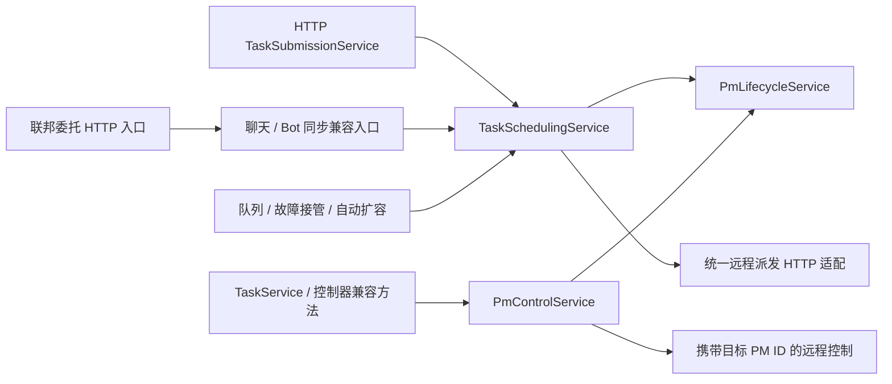

# PM 生命周期与统一调度：第二阶段

日期：2026-10-25；迭代：iter-105。承接 iter-104 的真实 YomkServerPy 接入。

## 实际变化

新增三个进程内业务服务，保留所有原控制器方法和 HTTP 路径。

| 服务 | 请求操作 | 责任 |
|---|---|---|
| PmLifecycleService | start / resume / stop / cancel / pause / inject_input / status / register_local | 本机 PM 所有权、并发互斥、退出排空、启动失败清理、身份校验与登记 |
| PmControlService | cancel_task / pause_task / inject_input_to_pm | 通过 PM→Worker 映射控制目标 PM，隔离本机和远程传输 |
| TaskSchedulingService | submit_task / relay / dispatch_local / dispatch_to_worker | 任务创建、预算、选站、本机优先、联邦委托、排队、接管与实际派发 |

`ServiceRuntime.ensure` 在运行时锁内完成服务的查找与首次注册，避免多个后台线程
各自创建生命周期服务。`get_service_runtime` 同样保护应用运行时的首次创建。
`request_sync` 供同步控制器兼容方法调用，拒绝异步 handler，防止协程被静默丢弃。
FastAPI 的异步门面通过 `await runtime.request` 将同步业务放入线程池。

## 生命周期并发契约

每个 Station 的生命周期服务持有一把 RLock。本机启动和恢复共用同一个 slot：
“检查空闲—创建—启动”由同一锁保护；重复启动同一个仍在运行的 task_id 返回既有
pm_id，避免网络重试重复创建 PM。不同任务并发启动只能一个占有 slot。

取消和停止先在锁内登记 transition、保存 retiring 引用并释放控制器指针，
然后在**锁外**调用 PM.cancel。暂停同样在锁外调用 PM.pause。原因是这些方法
会同步 HTTP 回报状态，回调可能进入队列派发；持锁等回调会产生锁与网络等待环。
finally 段清除 transition。取消抛异常时恢复原实例引用并返回失败，控制器不会
把尚未取消的任务误标为 cancelled。

slot 的 busy 判断既检查 `_running`，也检查主执行线程和进度线程是否仍存活，
并检查正在执行的 transition。取消请求返回与执行线程已经退出是不同事件：
退出中的 PM 进入 retiring 集合，线程结束前不把共享运行时交给新 PM。
兼容字段 `_local_pm_agent` 在取消后仍按旧接口要求设为 None，retiring 引用由服务保管。

部分启动/恢复失败时，候选 PM 会在锁外取消清理；仍存活的线程继续占用 retiring
状态，避免异常路径泄漏所有权。恢复成功会重新登记 PM 数据行和映射，保留 project_id，
使后续取消、迁移和运维查询能够定位恢复的 PM。

## 调度合并

旧 HTTP 与聊天各自实现任务创建、选站、起 PM 和登记；现在两者都进入
TaskSchedulingService.submit_task。TaskSubmissionService 只保留异步 HTTP 门面。
优先级、结构化 input_data、project_id 和联邦防环标记进入同一流程，项目预算检查
也不再因从聊天提交而绕过。HTTP 选站同时继承原聊天的 LAN 优先、同评级按负载排序规则。

队列接力与故障接管共用 dispatch_local；它把本机启动和任务/PM 登记合为临界区。
自动扩容与普通任务共用 `_dispatch_remote`：统一回报 URL、认证头、10 秒单次请求
超时、pm_id 校验、任务/PM 落库与映射。没有 pm_id 的 200 响应不会再进入 running。
重试仍由原 http_retry 传输层负责；本轮没有宣称实现跨节点 exactly-once。

同一任务正在远程派发时，会在服务内登记 claim，其他队列或本机派发不能同时接管。
claim 在 finally 中释放，派发前重读持久化任务状态，避免再次发送已经运行的任务。
网络等待期间被取消的任务保持 cancelled，并在获得远端 PM 身份后补发取消。

WS 任务事件统一进入原控制器 `_queue_ws_broadcast`，由原 ASGI 推送循环发送，
同步服务不在工作线程直接操作 WebSocket。联邦委托入口与 Worker 生命周期 HTTP
入口涉及的同步操作都在线程池执行，避免占住接收 PM 回报的事件循环。
联邦入口保留 input_data 与 project_id，跳数限制继续生效。

## 身份校验与向后兼容

原 `_local_*` 方法、submit_task_from_chat、_dispatch_queued_task、
_dispatch_task_to_worker、_start_local_pm_for_task 和三个 PM 控制方法都保留，
它们现在是 Yomk 请求门面。外部 import、历史 API 路径和旧无 body 调用继续可用。

本机控制操作传入 expected_pm_id，旧任务的残留映射不能取消、暂停或向新 PM 注入
回复。远程 stop/pause/cancel 支持可选 `{pm_id}` body，身份不符返回 409；
远程 inject-input 使用 `X-PM-ID` header 校验身份，保留原输入 JSON 原样传递。
新 Secretary 会携带这些身份信息；旧调用不提供身份时继续保持原行为。
远端身份保护需要执行侧同样升级，旧 Worker 忽略新参数时不能提供同等保证。

本轮针对 Station 内嵌 PM。独立 worker.py 执行引擎进一步迁移属于阶段 4，应用整体
启停与所有后台线程的统一生命周期属于阶段 7。服务内 claim 与锁是单进程机制，
不是跨进程/跨主机的分布式锁。既有 Station 主机级单实例约束继续有效。

## 验证与评价

保留原任务域 21 个端点的完整 OpenAPI 快照，结构比较仍相等；Worker 控制端点仅增加
可选身份信息，旧无 body 路径另有回归。新增 tests/test_pm_services.py 16 项行为用例：
12 路并发启动只产生一个 owner、同任务重试幂等、启动与恢复竞争、恢复登记、
取消后等待真实测试线程退出、取消回调重入无死锁、启动失败重试、旧实例控制隔离、
取消失败保留任务状态、HTTP/聊天选站一致、并发远程 claim、三种 Worker 身份校验、
同步总线拒绝 async handler、远程输入身份与原始 JSON 保持。

代码规模变化：station_scheduler.py 599→334 行，station_local_pm.py 537→355 行，
station_pm_control.py 260→113 行；这些行数减少主要来自把业务移入服务。
新增的服务方法均不超过 80 行，全库顶层超长函数由 33 降至 32。
收益是同一派发路径、明确的 PM slot 与可复现的并发契约，而不是单凭文件变短推断性能。
仍保留 controller 兼容引用、通用 dict 消息和 DB 访问；下一阶段继续拆分秘书、Bot、项目
与蓝图服务并引入类型化请求。本轮没有以在线 LLM 或真实多机长任务验证负载性能。
