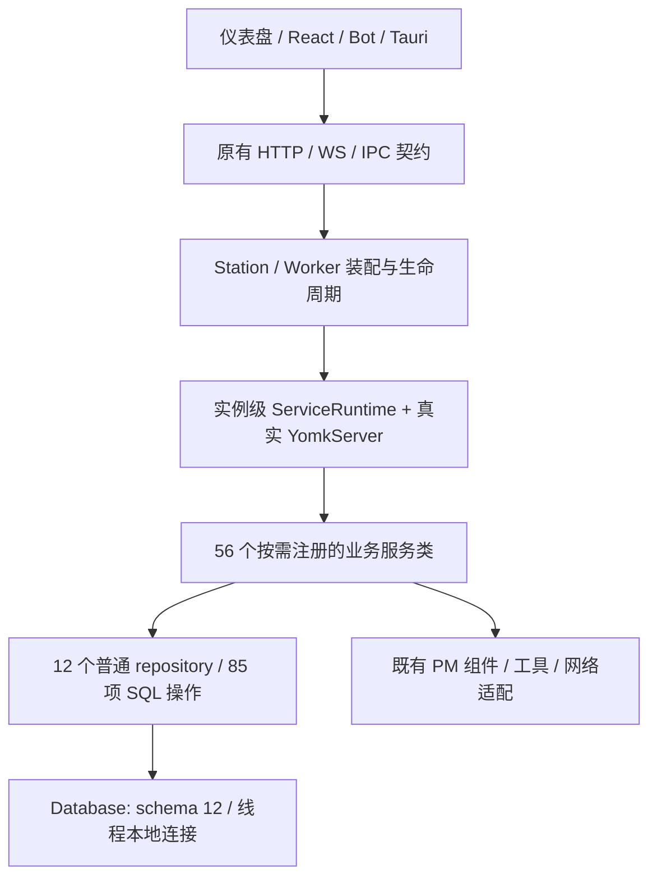

# YomkServerPy 重构评估与验收状态

日期：2026-10-25；迭代：iter-104～111；候选版本：0.41.0。

## 当前结论

已直接引入 YomkServerPy 1.4.20。阶段 1～7 的迁移与阶段回归完成，阶段 8 的前端、
版本、依赖和发布包代码已完成本机验证。**真实多机演练未完成，尚不能认定全项目已上线验收。**
当前已知测试节点无法完成健康检查，需要用户提供两台可达的隔离测试节点及联调条件。
本次源码发布包含原有 iter-103 取消竞态修复和 iter-104～111 重构，按两次业务提交保留归属；通过 sync_push.ps1 同步 Gitee master 与 GitHub CN。源码发布不代表真实多机验收放行。

这次改造的价值是职责、所有权和退出行为可验证，不是把进程内总线当作分布式框架。
网络发现、HTTP/WS、SQLite、PM/DAG 和权限仍使用 LAN Mesh 自己的协议与实现。

## 实现结构

每个 owner 的服务容器独立创建，兼容方法通过真实 `/Service/operation` 请求进入单一实现。
业务基类为 YomkService；注册、请求和内省来自实际框架源码。未使用不可重建的进程级
YomkApi 单例，也没有把 API Key 或持久化业务实体塞入 Context。
第三方来源、版本、许可证和最小适配记录在 `lan_mesh/_vendor/yomkserverpy/UPSTREAM.md`。

同步服务通过线程池进入 HTTP；异步 handler 在调用者事件循环 await。
业务失败保持 ServiceError 的状态码/detail，未预期异常继续传播。
ServiceCall 是兼容调用包，ChatRequest 是 Web/Bot 共用的类型化消息；旧方法参数仍保留，
未假称全部旧接口已经改成强类型 DTO。

## 迁移范围

| 阶段 | 完成的代码职责 | 状态 |
|---|---|---|
| 1 | 框架源码、实例运行时、任务/Agent/交付/记忆 21 端点 | 已完成 |
| 2 | PM 生命周期、身份校验、统一调度与派发 | 已完成 |
| 3 | 需求/会话历史/上下文/意图/命令，项目生命周期/预算/蓝图，45 个交互 API | 已完成 |
| 4 | 执行/技能/ReAct/CLI/提示词/LLM，工具、技能授权分发，独立 Worker | 已完成 |
| 5 | 模型路由、资源配置/选择/记账/上报/预警，14 个资源密钥 API | 已完成 |
| 6 | 聚合 repository、线程本地连接、原样 schema 与索引 | 已完成 |
| 7 | 主机/发现/同步/自愈/云传输/Bot/MCP/守护队列，层级停止与排空 | 已完成 |
| 8 | 仪表盘 16 源模块、共享认证、React/Tauri 客户端、版本与包验收 | 本机完成；实机待用户 |

原 API 路径和数据库主键保留。任务、交互、资源密钥、基础设施 OpenAPI 以及 sqlite_master
都有迁移前快照；27 个 Tauri command 的名称和参数保持。剩余兼容 HTTP 适配器的 76 处
同步领域、磁盘或网络调用也已移到线程池，避免阻塞自愈期间连状态查询都无法响应。
可替换 discovery 从请求时解析，修复路由装配后仍读旧实例的问题。

## 行为与所有权改进

- PM 启动先占用 slot；同任务重试幂等；旧线程退出前不复用；取消/暂停回调在锁外执行。
  Worker 的可选 pm_id/X-PM-ID 防止旧任务控制新的 PM，旧调用方式保持兼容。
- Web、Bot、联邦、队列、接管和扩容共享提交/实际派发入口，减少双路径状态分歧。
- 会话完整回复与历史操作串行，任务费用归因和当前技能在 finally 恢复，防止线程复用污染。
- 服务关闭拒绝新请求，在途请求仍可完成嵌套调用；最后一个请求退出才销毁框架。
  后台线程使用停止令牌，MCP 可停止，资源热重载先排空旧线程，关闭报告如实返回 pending。
- SQLite 每份状态一个事实源，repository 不持有跨线程连接，不给每条 SQL 增加总线开销。
- 前端共用 bootstrap Promise、登录世代隔离、个人 token 优先和失败重试，保持上传边界。
  PWA 同时缓存新脚本壳，原 DOM/CSS 和非认证业务源码保持。
- 版本从源码 VERSION.json 进入 wheel metadata，CLI 与 FastAPI version 统一。
  requirements.txt 由 pyproject.toml 生成；加密及测试 HTTP 依赖完整。

## 量化评价

开始时顶层 Python 模块 73 个，最大三个文件为 chat_handler 2659、database 2368、
agent_runtime 1779 行。现在分别为 634、817、743 行；project 433→76、station_sync 530→59。
这是职责迁移而非代码消失：新增服务、repository 和兼容层会增加文件数与调用层级。

20,000 次同步空业务微基准：直接函数约 0.047 微秒/次，完整路由约 6.43 微秒/次。
框架引入了可测的调用开销，不能据此宣称吞吐提升。没有真实 LLM 或跨机负载数据，
所以不报告延迟/吞吐改善百分比。

架构可维护性和故障隔离较原实现更好，主要收益有并发回归与契约测试支撑。
代价是字符串操作地址、兼容 owner 引用和更多模块；一次性删掉旧门面会破坏既有调用方，
因此本次保留。PM 的 Planner/Dispatcher/Monitor、DAG、密码学与纯计算已经具备边界，
没有为了套框架再增加无意义的消息跳转，也没有强制把所有线程迁到 EventLoop。

仍有技术债：部分装配函数/嵌套路由构建函数超过 80 行；默认资源管理器、事件与认证仍有
进程级兼容入口；可进一步用 Protocol 和 DTO 缩小 owner 依赖。现有 on_event 风格也可在
独立兼容性迭代中清理。以上不应被隐藏，但也不能用改名或压缩行数代替实际职责拆分。

## 验证与放行边界

最终隔离环境全量 **621 passed / 125.29s**，5 项现有依赖/生命周期 API 弃用提醒。
编译、控制器导入、158 文件未绑定名称扫描、依赖同步、201 条设计清单通过。
隔离环境使用 FastAPI 0.128.8、Starlette 0.52.1、Pydantic 2.14.1、websockets 13.1，
与原开发环境的关键兼容回归共同覆盖本轮实现。
已完成 6 项 Node 行为/IPC 测试，两套前端类型检查/生产构建；四个 Chromium 页面、37 个
认证请求、零 page error 与手机无横向溢出。真实 loopback HTTP 覆盖原生执行、取消和退出。
wheel 的 CLI/版本/前端资产/框架许可证/依赖与私有配置排除已验证。

隔离安装发现新 FastAPI 的文件上传 OpenAPI 与原契约不同，因此固定到 0.128.8，
没有放宽快照掩盖依赖漂移；其余声明范围内依赖在新虚拟环境验证。

真实双节点网络、在线模型、停机升级和回滚仍待实机演练。现在不能把本机测试等同于
多机交付、不能承诺 HTTP exactly-once 或立即终止任意外部 CLI。
具体环境条件与步骤见[候选包实机放行](08-infrastructure/yomk-rollout.md)。

详细设计：[PM](02-station-core/pm-service-phase2.md)、[执行](04-execution-engine/yomk-execution-services.md)、
[资源](05-resources-secrets/yomk-resource-services.md)、[持久化](02-station-core/yomk-repositories.md)、
[生命周期](08-infrastructure/yomk-lifecycle.md)、[前端](09-frontend/yomk-frontend.md)。
